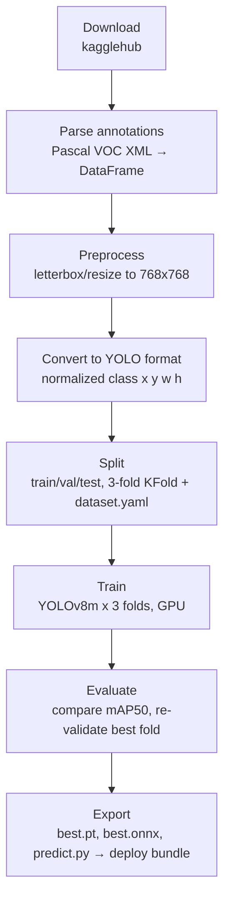
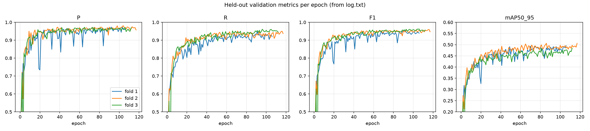
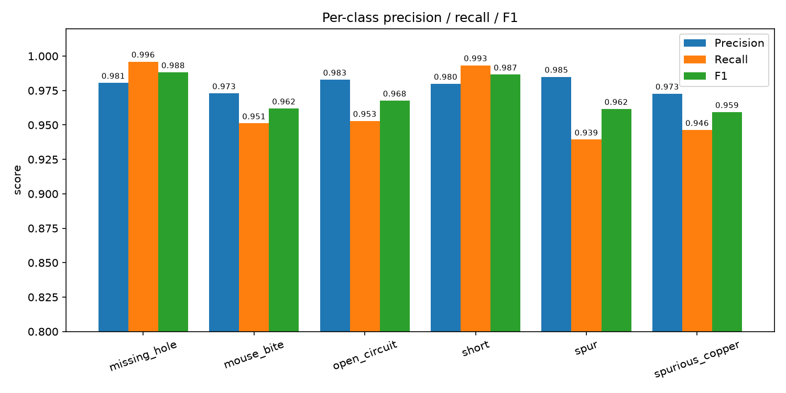
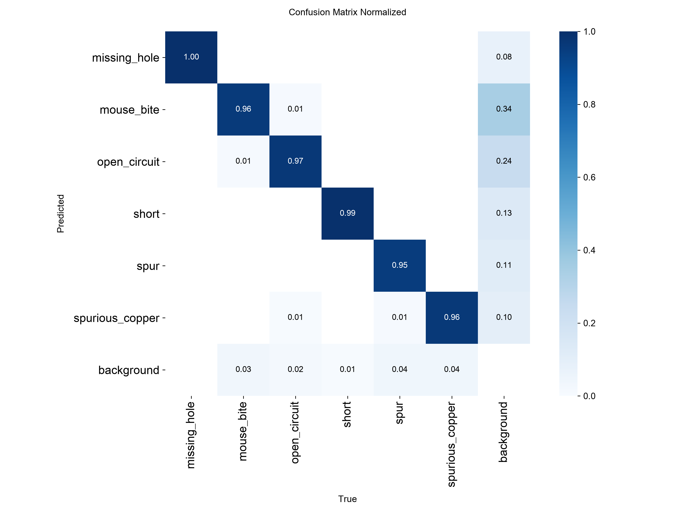
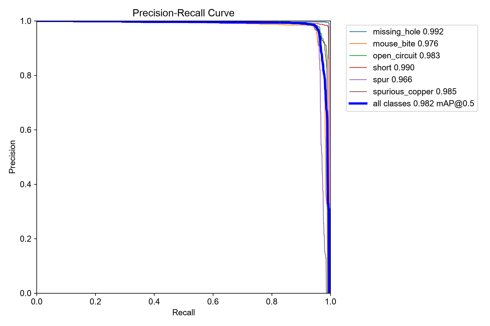
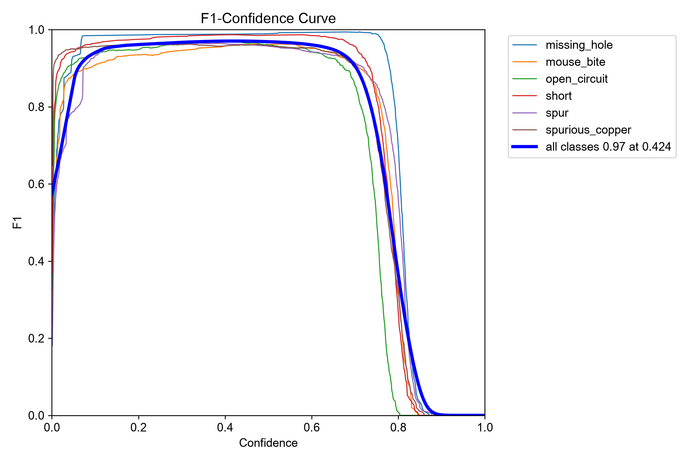
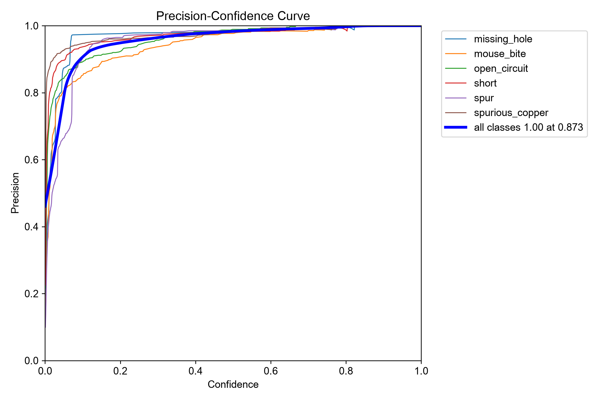
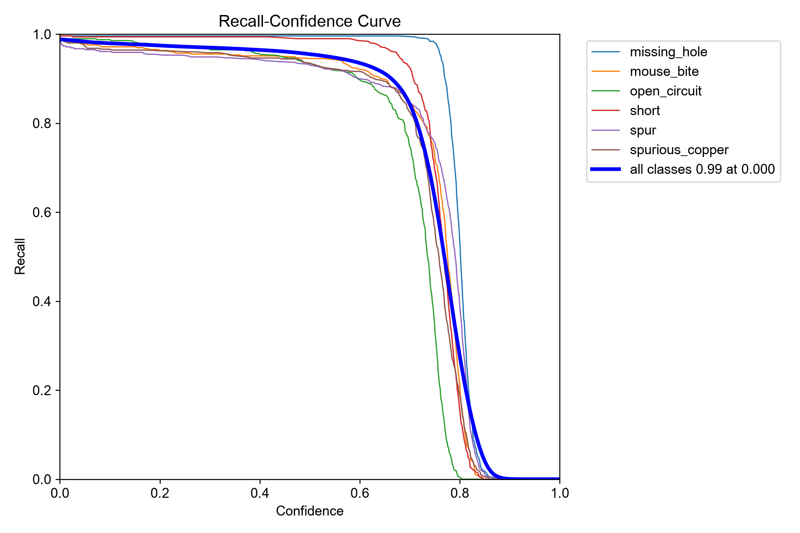
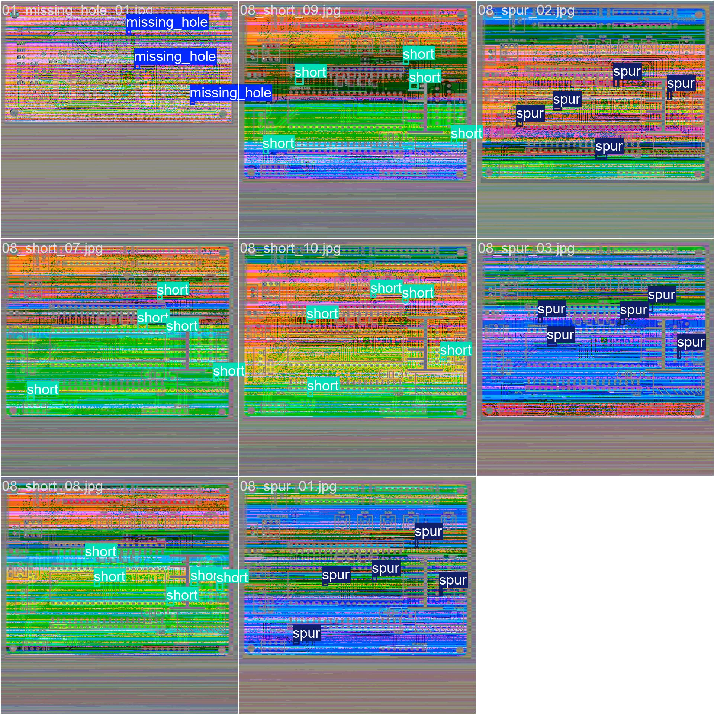
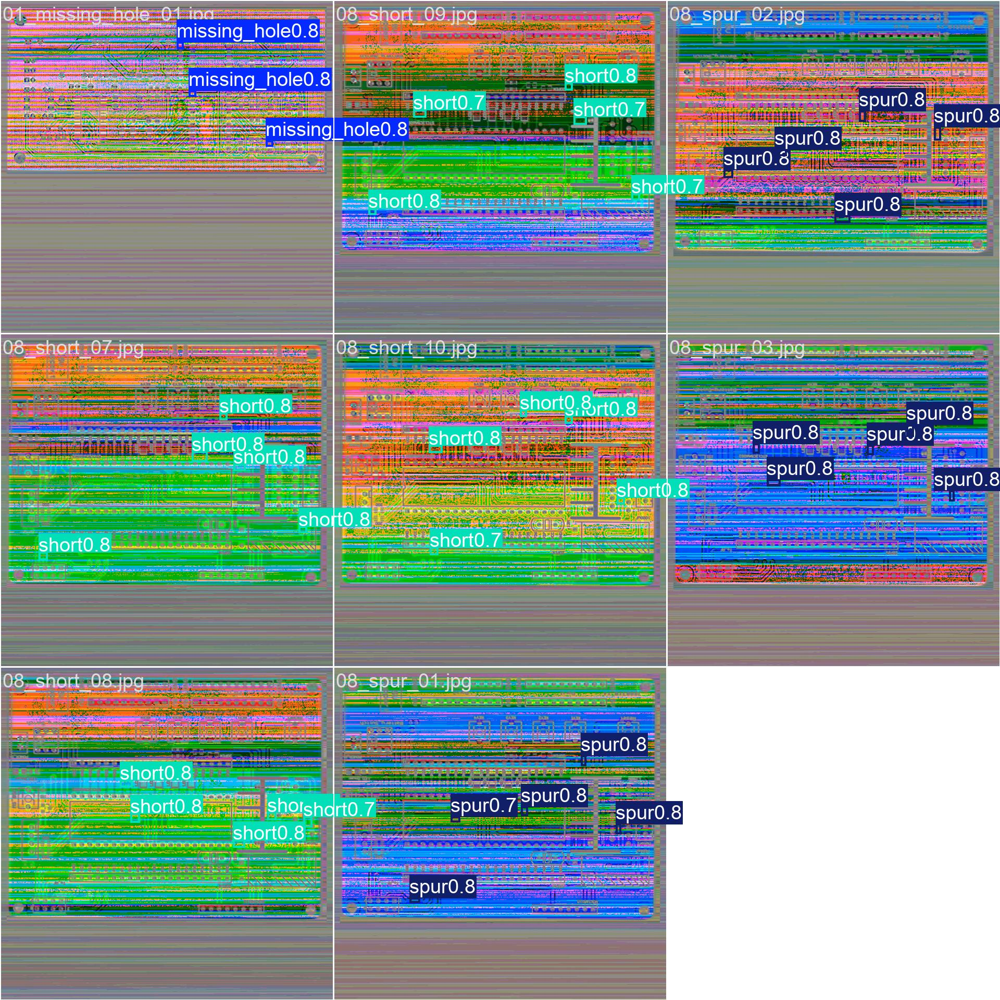

# PCB Defect Detection

Object detection pipeline that trains a YOLOv8 model to localize and classify manufacturing defects on printed circuit boards (PCBs).

## Dataset

Public synthetic PCB dataset ([akhatova/pcb-defects](https://www.kaggle.com/datasets/akhatova/pcb-defects) on Kaggle) containing 1386 images across 6 defect classes, with Pascal VOC (XML) bounding-box annotations:

- Missing hole
- Mouse bite
- Open circuit
- Short
- Spur
- Spurious copper

## Architecture / Pipeline

The full pipeline lives in [index.ipynb](index.ipynb) and runs end to end as follows:



1. **Download** — dataset pulled via `kagglehub`.
2. **Parse annotations** — Pascal VOC XML files are parsed into a single pandas DataFrame (`filename`, `class`, bounding box).
3. **Preprocess** — images are letterboxed/resized to 768x768 (aspect ratio preserved, padded), and annotations are rescaled to match.
4. **Convert to YOLO format** — bounding boxes are converted to normalized `class x_center y_center width height` label files.
5. **Split** — images/labels are split into train/val/test sets, then regrouped into 3 stratified folds using `KFold` for cross-validation, each with a generated `dataset.yaml`.
6. **Train** — a YOLOv8m model (`ultralytics`) is trained per fold on GPU with tuned hyperparameters (custom augmentation: mosaic, RandAugment, HSV jitter, copy-paste, etc.), tracking box/class/DFL loss curves.
7. **Evaluate** — folds are compared by `mAP50`; the best fold is re-validated with `.val()` to get precision, recall, mAP50, and mAP50-95 on its held-out split.
8. **Export** — the best fold's weights are exported into a self-contained deploy bundle: `best.pt`, `best.onnx` (via `onnx`/`onnxslim`), `classes.txt`, a standalone `predict.py` CPU-inference script, and a bundle `README.txt`, zipped for portability to another machine.

## Tech Stack

- **Model**: [Ultralytics YOLOv8](https://github.com/ultralytics/ultralytics) (`yolov8m`), PyTorch
- **Data handling**: pandas, NumPy, OpenCV, PyYAML
- **Validation**: scikit-learn (`KFold`)
- **Dataset access**: kagglehub
- **Visualization**: Matplotlib
- **Export/inference**: ONNX, ONNX Runtime, onnxslim
- **Environment/tooling**: Python 3.11–3.12, [uv](https://docs.astral.sh/uv/) for dependency management, Jupyter (via `ipykernel`)
- **PyTorch index**: CUDA 12.8 wheels (`pytorch-cu128`) for GPU training

## Project Structure

```
.
├── index.ipynb      # full pipeline: preprocessing, training, evaluation, export
├── main.py           # placeholder entrypoint
├── pyproject.toml    # dependencies (managed with uv)
└── working/           # generated at runtime (gitignored)
    ├── images_resized/     # letterboxed 768x768 images
    ├── output/              # YOLO-format images/labels + k-fold splits
    └── deploy/               # exported best.pt / best.onnx / predict.py bundle
```

`working/`, `runs/`, model weights (`*.pt`, `*.onnx`), and archives (`*.zip`, `*.7z`) are gitignored since they're large, regenerable build artifacts.

## Setup

```bash
uv sync
```

Requires a Kaggle account/API credentials for `kagglehub` to download the dataset, and a CUDA-capable GPU for training at the configured batch size/image size (768px, YOLOv8m).

## Usage

Run [index.ipynb](index.ipynb) top to bottom. It will:

1. Download and preprocess the dataset into `working/`.
2. Train 3 cross-validation folds (`epochs=180`, `imgsz=768`, `batch=8`).
3. Evaluate folds and pick the best one.
4. Produce a portable deploy bundle at `working/deploy/`.

### Running inference with the exported bundle

On any machine (no training code needed):

```bash
pip install ultralytics onnxruntime
python predict.py path/to/image.jpg
```

This loads `best.onnx` and prints detected defects with confidence scores, saving an annotated `prediction.jpg`.

## Results

Everything below is produced by [evaluate.py](evaluate.py) and saved in [eval_results/](eval_results/). Re-run it with `python evaluate.py`.

### Number-based metrics

**What the terms mean**

| Metric | Plain-English meaning |
| --- | --- |
| Precision | Of everything the model flagged as a defect, how much really was one. `1 - precision` is the false-alarm rate. |
| Recall | Of all real defects, how many the model found. `1 - recall` is the miss rate. |
| F1 | One number balancing precision and recall (their harmonic mean). |
| mAP50 | Average precision when a box counts as correct if it overlaps the true box by at least 50%. The standard "how good is the detector" score. |
| mAP50-95 | Same, but averaged over much stricter overlaps (50% to 95%). Rewards very tight boxes, so it is always lower. |

**Honest numbers: held-out folds (3-fold cross-validation, averaged)**

These come from images the model had not trained on, so they are the ones to quote.

| Metric | Score | Error rate |
| --- | --- | --- |
| Precision | 0.961 | ~3.9% of alerts are false alarms |
| Recall | 0.934 | ~6.6% of defects are missed |
| F1 | 0.947 | |
| mAP50 | 0.959 | |
| mAP50-95 | 0.495 | |

Per fold: [eval_results/training_curves_by_fold.csv](eval_results/training_curves_by_fold.csv). Per class and fold: [eval_results/heldout_per_class_by_fold.csv](eval_results/heldout_per_class_by_fold.csv).

| Class | Precision | Recall | F1 | mAP50 | mAP50-95 |
| --- | --- | --- | --- | --- | --- |
| missing_hole | 0.983 | 0.988 | 0.986 | 0.979 | 0.571 |
| mouse_bite | 0.938 | 0.921 | 0.929 | 0.963 | 0.483 |
| open_circuit | 0.964 | 0.946 | 0.955 | 0.966 | 0.458 |
| short | 0.954 | 0.956 | 0.955 | 0.963 | 0.492 |
| spur | 0.974 | 0.856 | 0.911 | 0.913 | 0.462 |
| spurious_copper | 0.954 | 0.936 | 0.945 | 0.970 | 0.502 |

**Caveat: final `best.pt` scored on all 693 images**

[eval_results/per_class_metrics.csv](eval_results/per_class_metrics.csv) scores the exported model on the full image set, which includes images it trained on. It is **optimistic, not a true test**: precision 0.979, recall 0.963, F1 0.971, mAP50 0.982, mAP50-95 0.573. Use the held-out table above for claims about real-world performance.

**About "RSA"**: this is object detection, so regression-style scores such as RMSE or R² do not apply. The equivalents are the metrics above (error rates = 1 - precision and 1 - recall).

### Graphs

#### Training curves


**What it shows:** how precision (P), recall (R), F1 and mAP50-95 on unseen images changed each epoch, one line per fold.
**What it means:** the lines climb quickly then flatten, so the model learned and then stopped improving. The three folds land close together, so the result is stable and not a lucky split.

#### Per-class precision / recall / F1


**What it shows:** three bars per defect type: precision, recall and F1.
**What it means:** taller is better. Every class is above ~0.94. `mouse_bite`, `spur` and `spurious_copper` have the lowest recall, meaning they are the ones most often missed. Note this chart is from the full-set evaluation, so it is optimistic.

#### Confusion matrix (normalized)


**What it shows:** for each real defect type (columns), what the model predicted (rows) at the deployment confidence of 0.25. Dark diagonal = correct.
**What it means:** the diagonal is 0.95 to 1.00, so classes are rarely confused with each other (off-diagonal values are about 0.01). Most errors are the "background" row and column: the model sometimes misses a defect (3 to 4% for several classes) or invents one on clean board (e.g. 0.34 of `mouse_bite` predictions column-wise). Raw counts: [confusion_matrix.png](eval_results/confusion_conf0.25/confusion_matrix.png).

#### Precision-Recall curve


**What it shows:** precision versus recall as the confidence threshold is swept. The area under each curve is that class's mAP50.
**What it means:** a curve hugging the top-right corner is ideal. These stay at ~1.0 precision until recall is ~0.95, then drop sharply. So the model can catch about 95% of defects with almost no false alarms; pushing past that costs precision fast. `spur` falls earliest, matching its lower recall.

#### F1-confidence curve


**What it shows:** F1 at each confidence threshold.
**What it means:** the peak is the best threshold to deploy at. A wide flat top means results are not sensitive to the exact value, so the default of 0.25 is safe.

#### Precision-confidence and Recall-confidence curves



**What they show:** precision and recall separately versus the confidence threshold.
**What they mean:** raising the threshold makes the model pickier (precision up, recall down); lowering it does the reverse. Use them to tune: raise the threshold if false alarms are costly, lower it if missed defects are costly.

#### Validation batches: labels vs. predictions



**What it shows:** the same boards with the true defect boxes (left) and the model's predicted boxes with confidence (right).
**What it means:** a visual sanity check. If boxes match in position and class, the model is doing what the numbers claim. More examples: `val_batch1_*` and `val_batch2_*` in the same folder.
